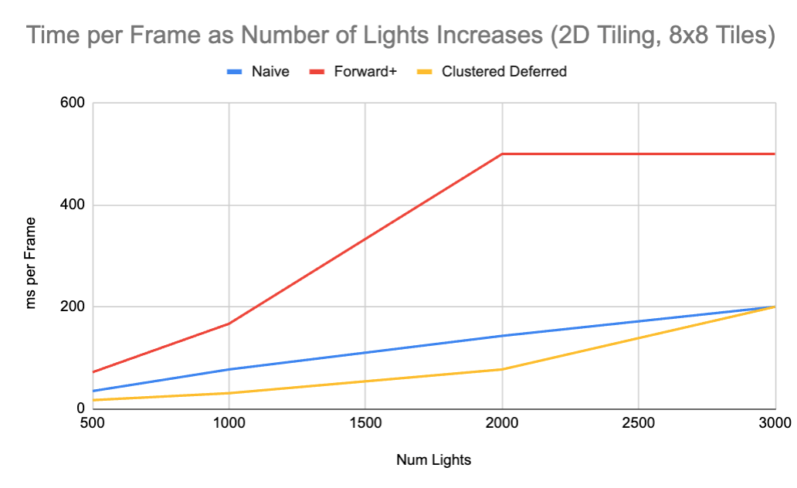
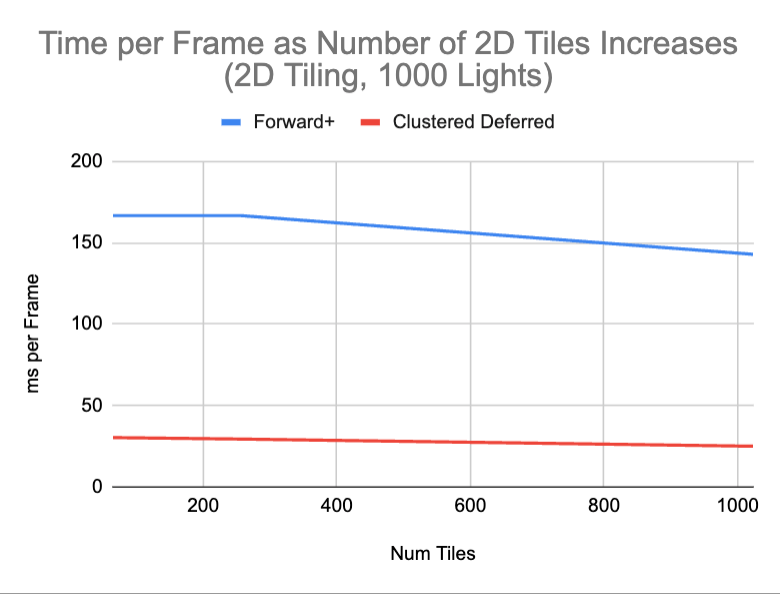
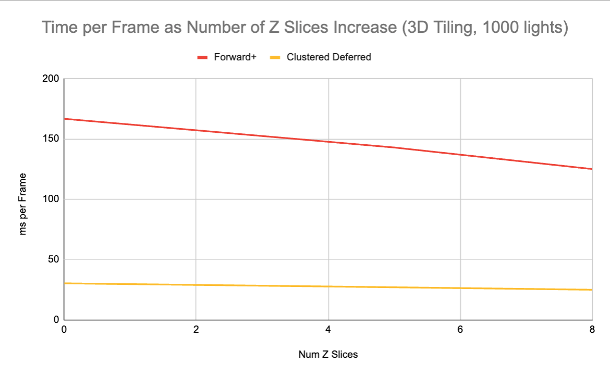

WebGL Forward+ and Clustered Deferred Shading
======================

**University of Pennsylvania, CIS 565: GPU Programming and Architecture, Project 4**

* Rose Kelly
  * [LinkedIn](www.linkedin.com/in/rose-kelly-b480b01a8)
* Tested on: Windows 11, i7-13700F @ 2.10 GHz 16GB, RTX 4060-Ti 8GB (PC)

### Live Demo

https://rosekelly6400.github.io/Project4-WebGPU-Forward-Plus-and-Clustered-Deferred/

### Demo Video/GIF

#### Features Implemented

- Naive Forward Rendering: 
- Forward+ (Forward Rendering with Clustered Lighting)
  - I implemented clustered lighting by splitting the screen up into a grid and splitting each cell on the camera's z axis into cubes/clusters. Each cluster tracks what lights affect fragments in that cluster and only those lights are used to calculate lighting for fragments in that cluster.
- Deferred Rendering with Clustered Lighting
  - For this approach, I implemented two passes to handle rendering: the first pass stores the position, normal, and texture color of each fragment visible on screen, and the second pass uses the first pass's data and the same cluster lighting information mentioned in the "Forward+" approach above to calculate the final color of each pixel/fragment.

- At least one screenshot of your project running
- A 30+ second video/gif of your project running showing all features (even though your demo can be seen online, it may not run on all computers, while a video will work everywhere)
- A link to your project's live website (see [GitHub Pages setup](#github-pages-setup))
- Performance analysis (see [above](#performance-analysis))

## Performance Analysis

### Forward+ vs Clustered Deferred Shading
- Which one is faster and why:
  - Clustered Deferred generally performed much faster than Forward+. This intuitively makes sense as Clustered Deferred only calculates lighting (which requires iterating through a number of lights, even with clustered lighting) for visible fragments while Forward+ performs these lighting calculations for every fragment in the frustum, even those that are occluded by fragments closer to the camera, wasting resources in scenes with many occluded fragments.
- Is one of them better at certain types of workloads:
  - Clustered Deferred is extremely well suited for scenes with lots of overlapping fragments since it doesn't waste time calculating lighting for fragments that are blocked by other fragments, while Forward+ calculates lighting for every fragment in the frustum. 
  - The majority of the time, Clustered Deferred outperformed Forward+ in my testing. One case where they were roughly matched was when I had the camera facing a wall (behind which there was nothing but empty space). This makes sense, as the advantage of Clustered Deferred is that it doesn't waste time rendering fragments blocked by other fragments, and in the case of facing a wall, there are few to no fragments blocking other fragments. There is additional overhead for Clustered Deferred compared to Forward+ as it needs to create normal, position, and color textures in the initial pass and then do an essentially pointless vertex shader before the final fragment shader pass. However, this overhead doesn't appear signficant as even in the "wall" scenario, the two approaches are roughly even.
- What are the benefits and tradeoffs of using one over the other:
  - Forward+ was slightly simpler to implement and in theory has less overhead, but practically I found clustered deferred to be superior in most cases.

Optimize your TypeScript and/or WGSL code. Chrome's profiling tools are useful for this. For each change that improves performance, show the before and after render times.
- using indices vs copying lights into cluster structure

If your Forward+ or Clustered Deferred renderer is running much slower than expected, make sure you are not making copies of large structs/arrays in shader code. You can use [pointers](https://google.github.io/tour-of-wgsl/types/pointers/using/) in WGSL to avoid this issue.

### Light Clustering
  - Overview: This feature improves performance by breaking up the scene into "clusters" or essentialy boxes in the scene and assigning any lights that affect that cluster to the cluster and using that data to iterate through only the cluster's lights when calculating lighting for fragments within the cluster.
  - Detailed performance improvement analysis of adding the feature.
  - Best and Worst Case Scenario for Performance Improvement: This feature is the most effective when there are many lights in a scene and what areas of the camera view are effected by lights is highly varied. In this case the clusters can cut out lights that affect one corner of the view, for example, but not the rest of the scene and save performance on trying to calculate lighting using irrelevant lights. The worst case is a scene with few lights and/or a scene where the lights hit almost all fragments in view. In this case creating cluster just generates overhead and doesn't save much lighting calculation since all clusters will have almost all of the lights in the view.
  - Tradeoffs: One significant tradeoff is additional overhead: creating the clusters via a compute shader before rendering generates some overhead, and fetching the lights by first fetching the cluster of the fragment also generates additional memory fetching overhead that can add up. Another possible tradeoff is visual artifacts, if the maximum number of lights per cluster is too low, you can see the outlines of the clusters where relevant lights are not being added to the cluster since it cant hold enough lights.

#### 2D Cluster Tiling

[lower ms per frame is better]

Across all approaches we see that ms per frame increases as the number of lights increases. When taking this data I set increased the max size of the cluster's "lights" array as I increased the number of lights since not doing this results in artifacts as the number of lights in the scene increases. This causes additional overhead when fetching memory for the clusters and their light indices, which I believe accounts for most of the performance degradation you can see in Forward+ and Clustered Deferred as the number of lights increases.

[lower ms per frame is better]

Increasing the number of clusters/tiles on the screen generally decreased the time to generate a frame. This is due to the fact that by decreasing the size of the cluster, you make the lights in that cluster more specific to the fragments in it, which means there are less worthless lighting calculations where the light affects some fragments in a cluster but not others. There is memory and calculation overhead to adding more clusters, but in the data points shown above the reduction in irrelevant lighting calculations makes increasing the number of tiles worth it.

#### 3D Clusters via Depth Slicing

[lower ms per frame is better]

In the previous graph, the tiles were just a 2D grid over the screen. However, I also implemented slicing these clusters up by depth to create even more clusters and further specifying the clusters to their fragments. Increasing the number of depth slices per 2D cluster improved performance by reducing the number of ms it took to generate a frame. Similar to the improvement discussed by increasing the number of 2D tiles/clusters, increasing the number of slices again specifies the lights assigned to each cluster to be more accurate to a larger percent of that cluster's fragments. Again this decreases the number of irrelevant lighting calculations per fragment, reducing the time it takes to generate a frame.

### Deferred Rendering with Light Clustering

  - Overview: This feature improves performance by performing one pass to collect the normal, position and color of the fragment/pixels that are actually visible on screen (not occluded) and then performs lighting calculation using the same lighting clusters discussed above on only the visible fragments. This is in contrast to Forward+ where the lighting calculation is performed on every fragment in view of the camera, even those that are occluded by other fragments. This is a massive waste of resources and as you would expect avoiding these useless calculations greatly increases performance.
  - Best and Worst Case Scenario for Performance Improvement: The best case scenario for this improvement is a view of a scene where there are lots of overlapping objects. This allows the deferred renderer to discard hidden fragments where a forward renderer would still make calculations for them. The worst case scenario would be a scene with no overlapping objects or occluded fragments. This would mean the first pass is largely worthless overhead.
  - Tradeoffs: Since you have to do two passes and store the normal, position, and color of the first pass into textures, there is additional overhead for this method. This is also slightly more complicated to implement that basic forward rendering.

[lower ms per frame is better]

Looking at the graph shown above again, you can see that Clustered Deferred performs the best due to its avoidance of performing lighting calculations on blocked fragments.

### Credits

- [Vite](https://vitejs.dev/)
- [loaders.gl](https://loaders.gl/)
- [dat.GUI](https://github.com/dataarts/dat.gui)
- [stats.js](https://github.com/mrdoob/stats.js)
- [wgpu-matrix](https://github.com/greggman/wgpu-matrix)

TODO
- RECORD DATA + MAKE GRAPHS for clustered and deferred
- TAKE VIDEO 

### Bloopers

- was writing my camera matrices into their struct by a few floats off